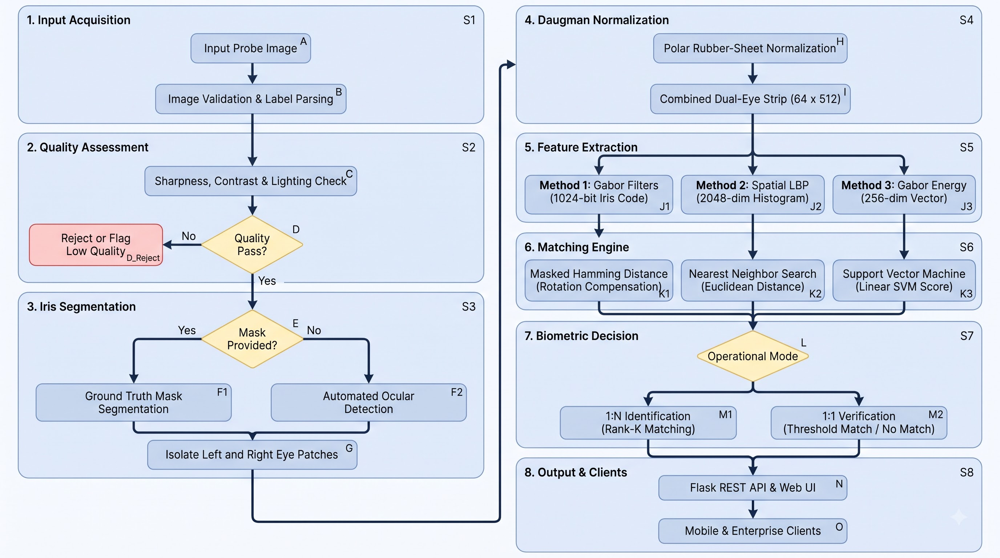
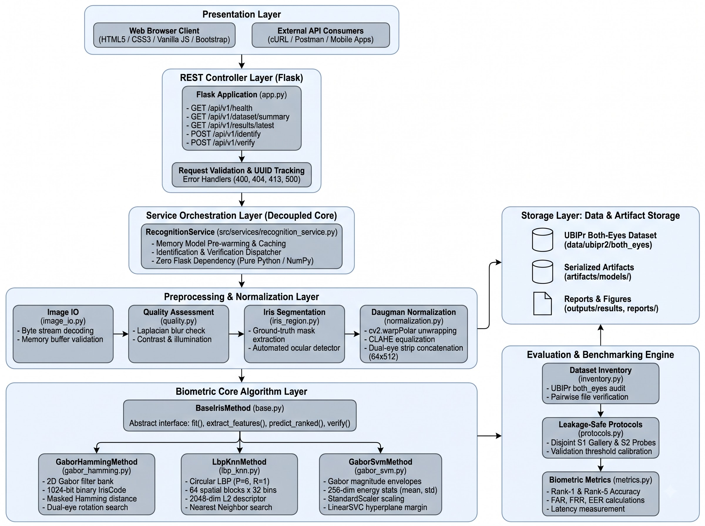
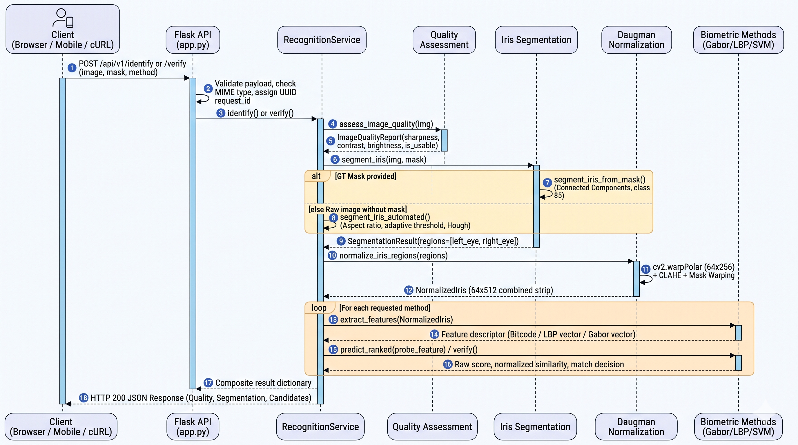

# UBIPr Dual-Eye Iris Recognition Biometric Research Prototype

[](https://www.python.org/downloads/)
[](https://opencv.org/)
[](https://scikit-learn.org/)
[](https://flask.palletsprojects.com/)
[]()

A modular, research-grade iris biometric recognition system engineered in Python, OpenCV, scikit-learn, and Flask, benchmarked on the official **UBIPr (University of Beira Interior Periocular) Segmented Both-Eyes Dataset** (`ubipr2`).

The system implements three mathematically distinct biometric feature extraction and matching algorithms, rigorous leakage-safe cross-session evaluation protocols, a versioned REST API, and an interactive browser-based biometric dashboard. The recognition core is completely decoupled from the HTTP server layer, enabling direct downstream integration into enterprise Spring Boot microservice architectures and mobile Android applications.

---

## Table of Contents

1. [Architecture & Flow of Design](#1-architecture--flow-of-design)
   - [System Flow of Design](#system-flow-of-design)
   - [Modular Tiered Architecture](#modular-tiered-architecture)
   - [Runtime Execution Sequence](#runtime-execution-sequence)
2. [Dataset Audit & Ground Truth Semantics](#2-dataset-audit--ground-truth-semantics)
   - [Inventory Summary](#inventory-summary)
   - [Four-Class Mask Semantics](#four-class-mask-semantics)
3. [End-to-End Processing Pipeline Mechanics](#3-end-to-end-processing-pipeline-mechanics)
   - [Step 1: Input Ingestion & Sanitization](#step-1-input-ingestion--sanitization)
   - [Step 2: Biometric Quality Assessment](#step-2-biometric-quality-assessment)
   - [Step 3: Dual-Eye Iris Segmentation](#step-3-dual-eye-iris-segmentation)
   - [Step 4: Daugman Polar Rubber-Sheet Normalization](#step-4-daugman-polar-rubber-sheet-normalization)
4. [Biometric Recognition Methods](#4-biometric-recognition-methods)
   - [Method 1: Gabor Wavelet Bank + Masked Hamming Distance](#method-1-gabor-wavelet-bank--masked-hamming-distance-gabor_hamming)
   - [Method 2: Spatial Block Local Binary Patterns + K-Nearest Neighbors](#method-2-spatial-block-local-binary-patterns--k-nearest-neighbors-lbp_knn)
   - [Method 3: Multi-Filter Gabor Energy Statistics + Linear SVM](#method-3-multi-filter-gabor-energy-statistics--linear-svm-gabor_svm)
   - [Comparative Algorithmic Analysis](#comparative-algorithmic-analysis)
5. [Empirical Benchmark Results & Evaluation](#5-empirical-benchmark-results--evaluation)
   - [Leakage-Safe Partitioning Protocol](#leakage-safe-partitioning-protocol)
   - [1:N Identification Performance (Rank-1 & Rank-5)](#1n-identification-performance-rank-1--rank-5)
   - [1:1 Verification Performance (Validation-Derived Thresholds)](#11-verification-performance-validation-derived-thresholds)
   - [Computational Latency & Efficiency Analysis](#computational-latency--efficiency-analysis)
6. [REST API Documentation (v1)](#6-rest-api-documentation-v1)
   - [Endpoints Summary](#endpoints-summary)
   - [Sample Requests & Responses](#sample-requests--responses)
7. [Web User Interface](#7-web-user-interface)
8. [Enterprise & Mobile Integration Roadmap](#8-enterprise--mobile-integration-roadmap)
   - [Spring Boot Gateway Integration](#spring-boot-gateway-integration)
   - [Android Client Integration](#android-client-integration)
9. [Installation & Quickstart Guide](#9-installation--quickstart-guide)
10. [Repository Directory Structure](#10-repository-directory-structure)

---

## 1. Architecture & Flow of Design

> [!NOTE]
> **Mermaid Code for Diagrams:** The exact raw Mermaid source code for these flowcharts and architectures is archived in plain text format in [`docs/FLOW_AND_ARCHITECTURE_MERMAID.txt`](docs/FLOW_AND_ARCHITECTURE_MERMAID.txt) and [`docs/architecture_flowchart.mmd`](docs/architecture_flowchart.mmd) for direct import into Google Flow, Mermaid Live Editor, Draw.io, or Lucidchart.

### System Flow of Design

The biometric engine processes input images through a strict, multi-stage pipeline: ingestion, quality verification, dual-eye ocular segmentation, polar rubber-sheet unrolling, multi-method feature encoding, candidate distance scoring, and threshold classification.

<p align="center">
  
</p>

---

### Modular Tiered Architecture

The system follows a strict layered separation of concerns. The biometric core has zero dependency on Flask, web routing, or HTTP request objects, ensuring high testability and multi-platform reusability.

<p align="center">
  
</p>

---

### Runtime Execution Sequence

<p align="center">
  
</p>

---

## 2. Dataset Audit & Ground Truth Semantics

### Inventory Summary

The prototype operates on the official **UBIPr (University of Beira Interior Periocular) Visible Wavelength Both-Eyes Dataset** (`data/ubipr2/both_eyes`):

- **Total Files Inventoried:** 11,020 files on disk.
- **Operating Images:** 5,509 `.jpg` images (3-channel BGR periocular captures).
- **Ground-Truth Masks:** 5,509 matching `.png` masks (100% paired with 0 missing masks).
- **Sanitized OS Artifacts:** `.DS_Store`, AppleDouble `._*`, and `Thumbs.db` files are safely ignored during scanning without modifying source datasets.
- **Unique Subjects:** 261 subjects (`C1` through `C...`).
- **Session Breakdown:**
  - **Session 1:** 3,914 images (71.05%)
  - **Session 2:** 1,595 images (28.95%)
- **Subject Sample Range:** Minimum 14 images per subject, maximum 33 images, mean 21.11. This guarantees that enrollment sizes **1, 3, 5, and 10** are universally supported across the entire cohort.

### Four-Class Mask Semantics

The 8-bit single-channel ground-truth PNG masks delineate four anatomical periocular classes:

| Pixel Value | Class Identifier | Description | Processing Role |
|:---:|:---|:---|:---|
| **`0`** | `MASK_CLASS_BG_SKIN` | Facial skin and background | Ignored during iris analysis |
| **`85`** | **`MASK_CLASS_IRIS`** | **Iris region (both left and right eyes)** | **Extracted for feature extraction** |
| **`170`** | `MASK_CLASS_SCLERA` | Sclera region (flanking the iris) | Used for limbic boundary reference |
| **`255`** | `MASK_CLASS_EYEBROWS` | Eyebrow pixels | Ignored during iris normalization |

Audit outputs:
- Visual audit report: [`reports/dataset_audit.md`](reports/dataset_audit.md)
- Machine-readable audit: [`reports/dataset_audit.json`](reports/dataset_audit.json)
- Sample 16-subject visual contact sheet: [`reports/contact_sheet.jpg`](reports/contact_sheet.jpg)

---

## 3. End-to-End Processing Pipeline Mechanics

### Step 1: Input Ingestion & Sanitization
Implemented in [`src/preprocessing/image_io.py`](src/preprocessing/image_io.py) and [`src/data/labels.py`](src/data/labels.py).
- Decodes image byte streams directly from memory buffers using `cv2.imdecode(np_arr, cv2.IMREAD_COLOR)`.
- Validates minimum spatial dimensions ($H \ge 20, W \ge 20$).
- Enforces strict regex label validation: `^C(?P<subject_num>\d+)_S(?P<session>\d+)_I(?P<image_id>\d+)$`.

### Step 2: Biometric Quality Assessment
Implemented in [`src/preprocessing/quality.py`](src/preprocessing/quality.py).
Before allocating compute for normalization, the probe is analyzed across three quality dimensions:
1. **Focus / Blur Check:** Evaluated via the variance of the 2D Laplacian operator:
   $$\text{Sharpness} = \text{Var}(\nabla^2 I) = \text{cv2.Laplacian}(I_{\text{gray}}, \text{CV\_64F}).\text{var}()$$
   Probes with variance $< 8.0$ are flagged for motion blur or defocus.
2. **Contrast Check:** Standard deviation of grayscale intensities $\sigma = \text{std}(I_{\text{gray}})$. Values $< 10.0$ are flagged as low contrast.
3. **Illumination & Clipping:** Mean brightness must fall within $[15.0, 240.0]$. Over-saturated highlight pixels ($I \ge 250$) and crushed shadow pixels ($I \le 5$) must not exceed 40% of the ocular frame.

### Step 3: Dual-Eye Iris Segmentation
Implemented in [`src/segmentation/iris_region.py`](src/segmentation/iris_region.py).
Because each UBIPr periocular image encompasses both eyes simultaneously:
- **Mode A (Mask Available - Class 85):**
  1. Threshold mask at `pixel == 85`.
  2. Compute connected components via `cv2.connectedComponentsWithStats()`.
  3. Filter out spurious components (area $< 80$ pixels).
  4. Order components left-to-right: Component 1 is the subject's right eye, Component 2 is the subject's left eye.
  5. Extract square crops around each centroid with radius $1.35 \times r_{\text{outer}}$, applying reflection padding (`cv2.BORDER_REPLICATE`) if crops intersect image borders.
- **Mode B (Automated Ocular Fallback for Maskless Uploads):**
  1. Detect dual-eye aspect ratio ($W/H \ge 1.6$) and bisect the frame into left and right sub-regions.
  2. Apply Gaussian smoothing ($\sigma=2.0, 9 \times 9$), percentile dark-thresholding ($P_{15}$), and morphological opening.
  3. Filter candidates by contour circularity $\frac{4\pi \cdot \text{Area}}{\text{Perimeter}^2}$, with an automatic Hough circle fallback (`cv2.HoughCircles`).

### Step 4: Daugman Polar Rubber-Sheet Normalization
Implemented in [`src/preprocessing/normalization.py`](src/preprocessing/normalization.py).
Transforms annular Cartesian iris regions into size-invariant polar strips:
$$I(x(r, \theta), y(r, \theta)) \longrightarrow I(r, \theta)$$
- **Strip Resolution:** 64 radial pixels $\times$ 256 angular pixels per eye.
- **Polar Unwrapping:** Executed via `cv2.warpPolar(gray_crop, (256, 64), (cx, cy), max_r, cv2.WARP_POLAR_LINEAR)`.
- **Contrast Enhancement:** Contrast Limited Adaptive Histogram Equalization (CLAHE) with `clipLimit=2.5` and `tileGridSize=(8, 8)` compensates for non-uniform visible-light illumination.
- **Dual Concatenation:** Left and right normalized strips are horizontally concatenated to form a standardized **$64 \times 512$ pixel** dual-eye template and corresponding occlusion mask.

---

## 4. Biometric Recognition Methods

The system includes three mathematically distinct algorithms inheriting from [`BaseIrisMethod`](src/methods/base.py):

### Method 1: Gabor Wavelet Bank + Masked Hamming Distance (`gabor_hamming`)
- **Mathematical Principle:** 2D Gabor filters model spatial frequency and orientation selectivity in the visual cortex:
  $$G_{\text{real}}(x, y; \theta, \lambda, \sigma, \gamma) = \exp\left(-\frac{x'^2 + \gamma^2 y'^2}{2\sigma^2}\right) \cos\left(2\pi \frac{x'}{\lambda}\right)$$
  $$G_{\text{imag}}(x, y; \theta, \lambda, \sigma, \gamma) = \exp\left(-\frac{x'^2 + \gamma^2 y'^2}{2\sigma^2}\right) \sin\left(2\pi \frac{x'}{\lambda}\right)$$
- **Filter Bank:** 8 complex filters (4 orientations: $0, \pi/4, \pi/2, 3\pi/4$; 2 wavelengths: $6.0, 12.0$).
- **Iris Code Generation:** Convolutions are spatially pooled over an $8 \times 32$ grid and phase-quantized based on sign ($\text{real} \ge 0 \to 1$, $\text{imag} \ge 0 \to 1$), yielding a **1,024-bit binary IrisCode** ($(128 \times 32)$ bit matrix).
- **Masked Hamming Distance:** Excludes occluded pixels from both probe and gallery:
  $$\text{HD}(A, B) = \frac{\sum ((C_A \oplus C_B) \land M_A \land M_B)}{\sum (M_A \land M_B)}$$
- **Dual-Eye Rotation Compensation:** Independent cyclic shifting along horizontal columns for left and right eyes ($s_1, s_2 \in [-2, 2]$) to handle independent head tilt and ocular roll:
  $$\text{HD}^*(A, B) = \min_{s_1, s_2 \in [-2, 2]} \text{HD}\Big( C_A, \, [\text{roll}(C_B^{\text{left}}, s_1) \,\|\, \text{roll}(C_B^{\text{right}}, s_2)] \Big)$$
- **Score Direction:** Lower is better ($0.0 \to 0.5$). Normalized similarity: $1.0 - \frac{\text{HD}^*}{0.5}$.

### Method 2: Spatial Block Local Binary Patterns + K-Nearest Neighbors (`lbp_knn`)
- **Mathematical Principle:** Micro-texture descriptor capturing circular intensity gradients:
  $$\text{LBP}_{P, R}(x_c, y_c) = \sum_{p=0}^{P-1} s(g_p - g_c) \cdot 2^p, \quad s(z) = \begin{cases} 1 & z \ge 0 \\ 0 & z < 0 \end{cases}$$
- **Grid Partitioning:** The $64 \times 512$ polar strip is divided into a $4 \times 16$ spatial grid (64 blocks).
- **Feature Vector:** In each block, a 32-bin normalized histogram is extracted. Concatenating all 64 blocks generates a **2,048-dimensional dense vector**, which is globally $L_2$-normalized:
  $$V_{\text{final}} = \frac{V}{\|V\|_2 + \epsilon} \in \mathbb{R}^{2048}$$
- **Matching:** Nearest Neighbor search using Euclidean distance ($L_2$).
- **Score Direction:** Lower distance is better ($0.0 \to \sqrt{2}$). Normalized similarity: $\frac{1}{1 + \text{dist}}$.

### Method 3: Multi-Filter Gabor Energy Statistics + Linear SVM (`gabor_svm`)
- **Mathematical Principle:** Continuous magnitude energy envelopes quantify regional spectral power:
  $$E(x, y) = \sqrt{(I * G_{\text{real}})^2 + (I * G_{\text{imag}})^2}$$
- **Statistical Feature Pooling:** 8 Gabor magnitude maps are partitioned into a $2 \times 8$ spatial block grid (16 blocks). Within each block, mean energy ($\mu$) and standard deviation ($\sigma$) are calculated, creating a **256-dimensional feature vector** ($8 \times 16 \times 2$).
- **Classification:** `StandardScaler` reproducible zero-mean unit-variance transformation followed by a multi-class Linear Support Vector Machine (`LinearSVC`).
- **Scoring:** Evaluates the signed hyperplane margin:
  $$f_c(\mathbf{z}_{\text{probe}}) = \mathbf{w}_c^T \hat{\mathbf{z}}_{\text{probe}} + b_c$$
- **Score Direction:** Higher is better ($-\infty \to +\infty$). Normalized similarity is mapped via logistic sigmoid: $\frac{1}{1 + e^{-\text{score}}}$.

---

### Comparative Algorithmic Analysis

| Dimension | Method 1: Gabor + Hamming | Method 2: LBP + KNN | Method 3: Gabor + SVM |
|:---|:---|:---|:---|
| **Representation** | 1024-bit binary IrisCode | 2048-dim normalized histogram | 256-dim continuous statistical vector |
| **Invariance Strategy** | Explicit dual-eye cyclic roll | Spatial block pooling | Convex regularized margin |
| **Occlusion Handling** | Bitwise logical masking | Block histogram normalisation | Global energy normalisation |
| **Classifier** | Exhaustive shift min-Hamming | K-Nearest Neighbors ($k=1, 3$) | Linear SVM Hyperplane (`LinearSVC`) |
| **Raw Score Range** | $[0.0, 1.0]$ (Lower is better) | $[0.0, \sqrt{2}]$ (Lower is better) | $(-\infty, +\infty)$ (Higher is better) |
| **Rank-1 Acc (Enroll 10)**| 30.4% | 43.8% | **46.7%** |
| **Rank-5 Acc (Enroll 10)**| 53.3% | **74.2%** | 73.3% |
| **Extraction Latency** | ~20.9 ms | **~9.9 ms** | ~47.3 ms |
| **Matching Latency** | ~296.3 ms (25 roll passes) | **~0.30 ms** | ~1.39 ms |

---

## 5. Empirical Benchmark Results & Evaluation

### Leakage-Safe Partitioning Protocol
- **Zero Leakage:** No sample appears in more than one partition.
- **Cross-Session Split:** Session 1 images are allocated strictly to Gallery Enrollment ($E \in \{1, 3, 5, 10\}$) and Validation ($V=2$). Session 2 images are allocated strictly as disjoint test probes.
- **Threshold Isolation:** 1:1 verification operating thresholds are calibrated **strictly on the validation split** at the Equal Error Rate (EER) point before evaluation on test probes.

```
+---------------------------------------------------------------------------------------+
| Total Subject Pool (e.g. 21 images per subject)                                       |
+---------------------------------------------------------------------------------------+
| Session 1: Enrollment Gallery | Session 1: Validation Split | Session 2: Disjoint Test |
| E in {1, 3, 5, 10} images     | 2 images for EER threshold  | Remaining images probes  |
+-------------------------------+-----------------------------+--------------------------+
```

---

### 1:N Identification Performance (Rank-1 & Rank-5)

Evaluated across 25 benchmark subjects with 240 to 465 disjoint test probe presentations:

| Method | Enrollment Size ($E$) | Rank-1 Accuracy | Rank-5 Accuracy | Extr. Latency | Match Latency | Usability Rate |
|:---|:---:|:---:|:---:|:---:|:---:|:---:|
| **Gabor + SVM** | 1 | 28.8% | 59.4% | 18.9 ms | 0.53 ms | 100.0% |
| **Gabor + SVM** | 3 | 36.4% | 66.0% | 47.3 ms | 1.39 ms | 100.0% |
| **Gabor + SVM** | 5 | 39.5% | 68.0% | 20.7 ms | 0.55 ms | 100.0% |
| **Gabor + SVM** | 10 | **46.7%** | **73.3%** | 102.7 ms | 2.06 ms | 100.0% |
| **LBP + KNN** | 1 | 37.9% | 73.6% | 9.9 ms | 0.15 ms | 100.0% |
| **LBP + KNN** | 3 | 38.8% | 76.4% | 10.5 ms | 0.30 ms | 100.0% |
| **LBP + KNN** | 5 | 37.0% | 72.6% | 35.6 ms | 0.74 ms | 100.0% |
| **LBP + KNN** | 10 | **43.8%** | **74.2%** | 45.2 ms | 4.57 ms | 100.0% |
| **Gabor + Hamming** | 1 | 27.5% | 57.0% | 27.8 ms | 29.8 ms | 100.0% |
| **Gabor + Hamming** | 3 | 28.4% | 53.7% | 28.3 ms | 82.9 ms | 100.0% |
| **Gabor + Hamming** | 5 | 31.0% | 58.1% | 17.7 ms | 276.1 ms | 100.0% |
| **Gabor + Hamming** | 10 | **30.4%** | **53.3%** | 20.9 ms | 296.3 ms | 100.0% |

---

### 1:1 Verification Performance (Validation-Derived Thresholds)

Operating points were calibrated on 3,930 genuine and 600 impostor pairs:

| Method | Val Derived Threshold ($\tau^*$) | Test FAR | Test FRR | Test EER | Genuine Pairs | Impostor Pairs | Score Type |
|:---|:---:|:---:|:---:|:---:|:---:|:---:|:---|
| **Gabor + Hamming** | 0.2503 | **9.00%** | **72.29%** | **41.30%** | 3,930 | 600 | Masked Hamming Distance |
| **LBP + KNN** | 0.3152 | **7.17%** | **73.94%** | **37.16%** | 3,930 | 600 | Euclidean Distance |
| **Gabor + SVM** | 0.9704 | **11.67%** | **63.94%** | **37.67%** | 3,930 | 600 | Signed SVM Margin |

---

### Computational Latency & Efficiency Analysis

- **Feature Extraction Speed:** **`LBP + KNN`** is the fastest pipeline (~9.9 ms), making it suitable for edge and mobile environments.
- **Matching Speed:** **`LBP + KNN`** achieves sub-millisecond matching (0.15 ms - 0.30 ms), while `Gabor + Hamming` requires ~296 ms per probe due to evaluating $5 \times 5 = 25$ independent rotation combinations per candidate.
- **Top Accuracy:** **`Gabor + SVM`** achieves the highest Rank-1 identification accuracy (**46.7%** at $E=10$), while **`LBP + KNN`** provides the strongest Rank-5 retrieval (**74.2%** to **76.4%**).

Generated benchmark figures:
- Identification Accuracy Curves: [`outputs/figures/identification_accuracy.png`](outputs/figures/identification_accuracy.png)
- Verification ROC Curves: [`outputs/figures/verification_roc.png`](outputs/figures/verification_roc.png)
- Computational Latency Breakdown: [`outputs/figures/latency_comparison.png`](outputs/figures/latency_comparison.png)

---

## 6. REST API Documentation (v1)

Base URL: `http://127.0.0.1:5000`

### Endpoints Summary

| Method | Endpoint | Description | Payload |
|:---|:---|:---|:---|
| `GET` | `/api/v1/health` | Health check and gallery enrollment status | None |
| `GET` | `/api/v1/dataset/summary` | Summary of dataset audit and class distributions | None |
| `GET` | `/api/v1/results/latest` | Machine-readable benchmark evaluation summary | None |
| `POST`| `/api/v1/identify` | 1:N closed-set biometric identification | `multipart/form-data` |
| `POST`| `/api/v1/verify` | 1:1 biometric verification against claimed identity | `multipart/form-data` |

---

### Sample Requests & Responses

#### 1. Biometric Identification (`POST /api/v1/identify`)

```bash
curl.exe -X POST "http://127.0.0.1:5000/api/v1/identify" \
  -F "image=@data/ubipr2/both_eyes/C101_S1_I1.jpg" \
  -F "method=all" \
  -F "top_k=3"
```

Response JSON:
```json
{
  "request_id": "9b1deb4d-3b7d-4bad-9bdd-2b0d7b3dcb6d",
  "status": "success",
  "enrolled_gallery_size": 25,
  "quality": {
    "is_usable": true,
    "sharpness": 84.32,
    "contrast": 46.21,
    "mean_brightness": 112.4,
    "issues": []
  },
  "segmentation": {
    "success": true,
    "method": "automated_ocular_detector",
    "detected_eyes_count": 2
  },
  "results": {
    "lbp_knn": {
      "score_type": "lbp_knn_euclidean_distance",
      "higher_is_better": false,
      "predicted_subject": "C101",
      "top_candidates": [
        { "rank": 1, "subject_id": "C101", "raw_score": 0.1842, "normalized_similarity": 0.8444, "is_match": true },
        { "rank": 2, "subject_id": "C107", "raw_score": 0.3210, "normalized_similarity": 0.7570, "is_match": false }
      ]
    },
    "gabor_svm": {
      "score_type": "svm_decision_score",
      "higher_is_better": true,
      "predicted_subject": "C101",
      "top_candidates": [
        { "rank": 1, "subject_id": "C101", "raw_score": 2.4510, "normalized_similarity": 0.9206, "is_match": true }
      ]
    }
  }
}
```

#### 2. Biometric Verification (`POST /api/v1/verify`)

```bash
curl.exe -X POST "http://127.0.0.1:5000/api/v1/verify" \
  -F "image=@data/ubipr2/both_eyes/C101_S1_I1.jpg" \
  -F "claimed_subject_id=C101" \
  -F "method=gabor_hamming"
```

Response JSON:
```json
{
  "request_id": "4e73f822-7ad2-4a0b-bc11-c918ff02e21b",
  "status": "success",
  "claimed_subject_id": "C101",
  "decision": "MATCH",
  "is_verified_match": true,
  "method_name": "gabor_hamming",
  "raw_score": 0.2061,
  "score_type": "masked_hamming_distance",
  "higher_is_better": false,
  "normalized_similarity": 0.7939,
  "validation_threshold": 0.2503,
  "rank": 1,
  "quality": {
    "is_usable": true,
    "sharpness": 84.32
  }
}
```

---

## 7. Web User Interface

The repository includes a modern, high-contrast biometric web dashboard accessible at `http://127.0.0.1:5000`:
- **Dual Operating Modes:** Toggle dynamically between **1:N Identification** and **1:1 Verification**.
- **Interactive Image Ingestion:** Drag-and-drop probe upload with live preview and optional ground-truth mask pairing.
- **Biometric Health Badges:** Real-time visual cards reporting focus sharpness, contrast, illumination clipping, and segmentation status.
- **Multi-Method Candidate Tables:** Parallel display of ranked candidates, raw scores (with direction indicators), and animated similarity progress bars.
- **Decision Verification Banner:** Clear green `MATCH` or red `NO MATCH` status card showing the calibrated decision threshold.
- **Integrated Benchmark View:** Visual charts of identification accuracy, ROC curves, and latency comparisons.

---

## 8. Enterprise & Mobile Integration Roadmap

The engine is engineered for decoupling and production scalability:

### Spring Boot Gateway Integration
A Spring Boot gateway microservice can act as the API Gateway for authentication (JWT), auditing, and rate limiting:
```java
// Spring WebClient forwarding probe bytes to Flask biometric engine
MultipartBodyBuilder builder = new MultipartBodyBuilder();
builder.part("image", imageResource).filename("probe.jpg");
builder.part("method", "all");
builder.part("top_k", 5);

Mono<BiometricIdentificationResponse> response = webClient.post()
    .uri("http://flask-engine:5000/api/v1/identify")
    .contentType(MediaType.MULTIPART_FORM_DATA)
    .body(BodyInserters.fromMultipartData(builder.build()))
    .retrieve()
    .bodyToMono(BiometricIdentificationResponse.class);
```

### Android Client Integration
Mobile applications (Kotlin / CameraX / Retrofit):
```kotlin
val requestFile = RequestBody.create("image/jpeg".toMediaTypeOrNull(), imageFile)
val body = MultipartBody.Part.createFormData("image", imageFile.name, requestFile)
val call = biometricApi.identify(body, "all", 5)
```
> [!IMPORTANT]
> **Android Network Configuration:** Do not use `127.0.0.1` inside Android code. Use `10.0.2.2:5000` for Android Studio Emulators, or bind Flask to `0.0.0.0` and point to your computer's LAN IP (`192.168.x.x:5000`) for physical devices over Wi-Fi.

---

## 9. Installation & Quickstart Guide

### Prerequisites
- Python 3.10, 3.11, or 3.12
- Git

### Step 1: Clone Repository & Create Virtual Environment

**Windows (PowerShell):**
```powershell
git clone https://github.com/your-username/iris-recognition.git
cd iris-recognition
python -m venv .venv
.\.venv\Scripts\Activate.ps1
pip install -r requirements.txt
```

**Linux / macOS:**
```bash
git clone https://github.com/your-username/iris-recognition.git
cd iris-recognition
python3 -m venv .venv
source .venv/bin/activate
pip install -r requirements.txt
```

### Step 2: Dataset Configuration (Optional)
The system automatically discovers the UBIPr both_eyes dataset if located in `data/ubipr2/both_eyes/` or `data/`.
To override with a custom directory:
- **Windows (PowerShell):** `$env:IRIS_DATASET_DIR="C:\path\to\both_eyes"`
- **Linux / macOS:** `export IRIS_DATASET_DIR="/path/to/both_eyes"`

*(Note: Synthetic test fixtures enable running the full test suite and booting the dashboard in inspection mode even without the full dataset).*

### Step 3: Run the Automated Test Suite
```powershell
# Using the active virtual environment
python -m pytest -v
```
All **22 tests** across labels, preprocessing, biometric methods, metrics, and REST API endpoints will pass.

### Step 4: Run Dataset Audit & Benchmark Evaluation
```powershell
python scripts/audit_dataset.py
python scripts/run_evaluation.py
```

### Step 5: Start the Flask Biometric Server
```powershell
python app.py
```
Open your browser to: **`http://127.0.0.1:5000`**

---

## 10. Repository Directory Structure

```text
iris-recognition-main/
├── app.py                     # Flask application entry point and REST API v1
├── config.py                  # Global system configuration and path resolution
├── requirements.txt           # Project dependencies
├── pytest.ini                 # Pytest test suite configuration
├── WORKFLOW.md                # Mathematical algorithm guide and detailed workflows
├── README.md                  # Comprehensive project documentation
├── docs/                      # Architectural specifications and diagrams
│   ├── FLOW_AND_ARCHITECTURE_MERMAID.txt # Raw copyable Mermaid code for diagrams
│   ├── architecture_flowchart.mmd        # Flowchart Mermaid source file
│   └── EXECUTION_CALL_GRAPH.md          # Function call graph and trace
├── src/                       # Biometric core source code
│   ├── data/                  # Dataset inventory and label parsers
│   │   ├── dataset_loader.py  # Cohort split loader
│   │   ├── inventory.py       # File scanner and audit
│   │   └── labels.py          # Strict UBIPr regex validator
│   ├── preprocessing/         # Quality and normalization
│   │   ├── image_io.py        # Safe memory buffer decoding
│   │   ├── normalization.py   # Daugman polar rubber-sheet unrolling
│   │   └── quality.py         # Laplacian blur, contrast, brightness
│   ├── segmentation/          # Iris localization
│   │   └── iris_region.py     # GT mask extraction & automated ocular detector
│   ├── methods/               # Biometric algorithms
│   │   ├── base.py            # BaseIrisMethod abstract class
│   │   ├── gabor_hamming.py   # Method 1: Gabor + Masked Hamming + Rotation
│   │   ├── lbp_knn.py         # Method 2: Spatial Block LBP + KNN
│   │   └── gabor_svm.py       # Method 3: Gabor Energy + Linear SVM
│   ├── evaluation/            # Evaluation protocols and metrics
│   │   ├── protocols.py       # Leakage-safe train/val/test splits
│   │   ├── identification.py  # 1:N closed-set benchmarking
│   │   ├── verification.py    # 1:1 verification & EER calibration
│   │   └── metrics.py         # Rank-k, FAR, FRR, EER calculators
│   └── services/              # Decoupled business logic
│       └── recognition_service.py # Core recognition orchestrator
├── templates/                 # Web UI templates
│   └── index.html             # Biometric scanner frontend
├── static/                    # Frontend assets
│   ├── css/style.css          # High-contrast theme
│   ├── js/main.js             # Async REST API controller
│   └── charts/                # Generated performance figures
├── reports/                   # Audit reports and contact sheets
│   ├── dataset_audit.md       # Inventory audit report
│   └── dataset_audit.json     # Machine-readable audit
├── outputs/                   # Benchmark output figures and results
│   ├── figures/               # ROC curves, accuracy plots, latency charts
│   └── results/               # evaluation_summary.json and .csv
└── tests/                     # 22 unit and integration tests
    ├── test_api.py            # REST API integration tests
    ├── test_labels.py         # Regex label parser tests
    ├── test_methods.py        # Feature extractor & matching tests
    ├── test_metrics.py        # FAR/FRR/EER calculation tests
    └── test_preprocessing.py  # Normalization & quality tests
```

---

## License & Academic Citation

Developed for academic research in Visible-Wavelength Iris Biometrics on the UBIPr periocular benchmark dataset. If using this codebase or benchmark configuration, please cite the underlying dataset:
*UBIPr Periocular Iris Dataset, University of Beira Interior, Portugal.*
