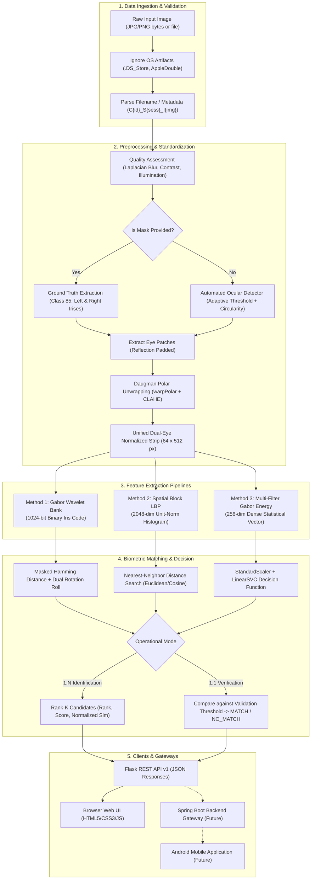
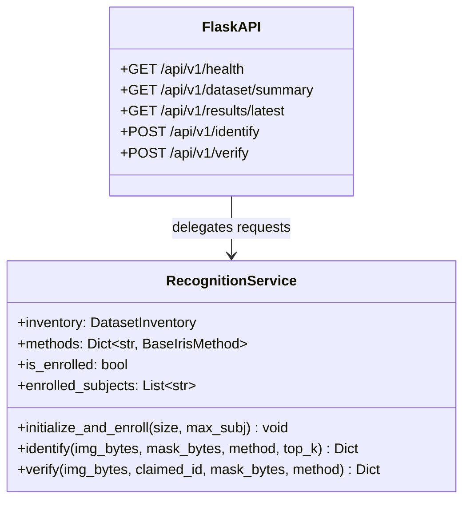

# UBIPr Dual-Eye Iris Recognition: End-to-End Workflow & Algorithm Guide

This document provides a comprehensive technical breakdown of the **UBIPr Dual-Eye Iris Biometric Recognition System**. It details the end-to-end processing pipeline, from raw visible-wavelength image ingestion to final biometric matching, and offers an in-depth mathematical and algorithmic explanation of all three implemented recognition methods.

---

## Table of Contents
1. [End-to-End System Workflow](#1-end-to-end-system-workflow)
2. [Step-by-Step Pipeline Mechanics](#2-step-by-step-pipeline-mechanics)
   - [Step 1: Dataset Ingestion & Label Parsing](#step-1-dataset-ingestion--label-parsing)
   - [Step 2: Biometric Image Quality Assessment](#step-2-biometric-image-quality-assessment)
   - [Step 3: Dual-Eye Iris Segmentation](#step-3-dual-eye-iris-segmentation)
   - [Step 4: Daugman Polar Rubber-Sheet Normalization](#step-4-daugman-polar-rubber-sheet-normalization)
3. [Deep Dive into the Three Biometric Recognition Processes](#3-deep-dive-into-the-three-biometric-recognition-processes)
   - [Process 1: Multi-Scale Gabor Filter Bank + Masked Hamming Distance](#process-1-multi-scale-gabor-filter-bank--masked-hamming-distance-gabor_hamming)
   - [Process 2: Spatial Block Local Binary Patterns (LBP) + K-Nearest Neighbors](#process-2-spatial-block-local-binary-patterns-lbp--k-nearest-neighbors-lbp_knn)
   - [Process 3: Multi-Filter Gabor Energy Statistics + Linear Support Vector Machine](#process-3-multi-filter-gabor-energy-statistics--linear-support-vector-machine-gabor_svm)
4. [Comparative Summary of the Three Processes](#4-comparative-summary-of-the-three-processes)
5. [Evaluation Protocols & Leakage Prevention](#5-evaluation-protocols--leakage-prevention)
6. [API Orchestration & Service Layer Architecture](#6-api-orchestration--service-layer-architecture)
7. [Future Android & Spring Boot Integration](#7-future-android--spring-boot-integration)

---

## 1. End-to-End System Workflow

The following flowchart illustrates the complete lifecycle of an image within the biometric pipeline, covering both gallery enrollment and probe matching (1:N Identification and 1:1 Verification):



---

## 2. Step-by-Step Pipeline Mechanics

### Step 1: Dataset Ingestion & Label Parsing
Implemented in [`src/data/inventory.py`](file:///c:/Users/Piyush/OneDrive/Desktop/iris-recognition-main/iris-recognition-main/src/data/inventory.py) and [`src/data/labels.py`](file:///c:/Users/Piyush/OneDrive/Desktop/iris-recognition-main/iris-recognition-main/src/data/labels.py).

- **Strict Label Regex:** Every valid sample adheres to the official UBIPr standard:
  $$\text{Regex: } \verb|^C(?P<subject_num>\d+)_S(?P<session>\d+)_I(?P<image_id>\d+)$|$$
  Example: `C101_S1_I1.jpg` indicates Subject ID `C101`, Session `1`, Image index `1`.
- **Integrity Rule:** Metadata files generated by macOS (`.DS_Store`, AppleDouble `._*`) and Windows (`Thumbs.db`) are ignored. Source dataset files are strictly read-only.
- **Mask Pairing:** Each `.jpg` image is paired with its corresponding ground-truth `.png` segmentation mask. Across the 11,020 inventoried files, exactly 5,509 images and 5,509 masks are paired with 100% concordance.

---

### Step 2: Biometric Image Quality Assessment
Implemented in [`src/preprocessing/quality.py`](file:///c:/Users/Piyush/OneDrive/Desktop/iris-recognition-main/iris-recognition-main/src/preprocessing/quality.py).

Before spending compute on segmentation and feature extraction, the input image undergoes automated quality filtering:
1. **Sharpness (Focus / Blur):** Evaluated via the variance of the 2D Laplacian operator:
   $$\text{Sharpness} = \text{Var}(\nabla^2 I) = \frac{1}{HW} \sum_{x,y} \left( \nabla^2 I(x,y) - \mu_{\nabla^2} \right)^2$$
   Images with variance $< 8.0$ are flagged for excessive motion blur or defocus.
2. **Contrast:** Measured via the global standard deviation of pixel intensities:
   $$\sigma = \sqrt{\frac{1}{HW} \sum_{x,y} (I(x,y) - \mu)^2}$$
   Images with $\sigma < 10.0$ are flagged as low contrast.
3. **Illumination & Clipping:** Mean intensity must lie within $[15.0, 240.0]$. Saturated highlight pixels ($I \ge 250$) and crushed shadow pixels ($I \le 5$) must not exceed 40% of the image area.

---

### Step 3: Dual-Eye Iris Segmentation
Implemented in [`src/segmentation/iris_region.py`](file:///c:/Users/Piyush/OneDrive/Desktop/iris-recognition-main/iris-recognition-main/src/segmentation/iris_region.py).

Because UBIPr "both_eyes" images contain wide periocular views with both eyes, the system isolates each iris independently:

#### Mode A: Ground-Truth Mask Guided Segmentation
When an official `.png` mask is available, the system targets pixel value `85` (the designated UBIPr Iris class):
1. Create a binary mask $M_{\text{iris}} = (M == 85)$.
2. Perform connected component analysis (`cv2.connectedComponentsWithStats`).
3. Discard noise components (area $< 80$ px).
4. Sort components by horizontal coordinate $x$:
   - First component: Left side in image (person's Right Eye).
   - Second component: Right side in image (person's Left Eye).
5. Extract bounding boxes and center centroids $(c_x, c_y)$.
6. Crop a square region of side $2 \times 1.35 \times r_{\text{outer}}$ around each centroid, applying reflection border padding (`cv2.BORDER_REPLICATE`) if crops touch image boundaries.

#### Mode B: Automated Ocular Detector (Upload Fallback)
When a raw image is uploaded without a mask (e.g. from the web interface or external client):
1. Assess aspect ratio: if $W/H \ge 1.6$, split the image into left and right halves.
2. In each half, apply Gaussian smoothing and percentile-based adaptive thresholding to detect dark ocular components (pupil + iris).
3. Filter contours by size, eccentricity, and circularity:
   $$\text{Circularity} = \frac{4 \pi \cdot \text{Area}}{\text{Perimeter}^2}$$
4. If circularity scoring fails, fallback to Hough Circle Transform (`cv2.HoughCircles`) to locate corneal boundaries.

---

### Step 4: Daugman Polar Rubber-Sheet Normalization
Implemented in [`src/preprocessing/normalization.py`](file:///c:/Users/Piyush/OneDrive/Desktop/iris-recognition-main/iris-recognition-main/src/preprocessing/normalization.py).

To eliminate variations caused by camera distance, pupil dilation, and pupil-to-limbus stretching, each annular iris patch is unrolled into polar coordinates:

$$I(x(r, \theta), y(r, \theta)) \longrightarrow I(r, \theta)$$

Where:
$$x(r, \theta) = (1 - r) x_p(\theta) + r x_i(\theta)$$
$$y(r, \theta) = (1 - r) y_p(\theta) + r y_i(\theta)$$
For $r \in [0, 1]$ and $\theta \in [0, 2\pi]$.

- **Per-Eye Strip Dimensions:** $64 \text{ px (radial resolution)} \times 256 \text{ px (angular resolution)}$.
- **Dual-Eye Horizontal Concatenation:** Eye 1 ($64 \times 256$) and Eye 2 ($64 \times 256$) are concatenated horizontally to produce a single standard strip of **$64 \times 512$ pixels**.
- **Illumination Equalization (CLAHE):** Contrast Limited Adaptive Histogram Equalization with clip limit $2.5$ and grid size $8 \times 8$ is applied to overcome ambient visible-light shadow gradients.
- **Normalized Validity Mask:** The segmentation mask is mapped using identical polar parameters with nearest-neighbor interpolation (`cv2.INTER_NEAREST`), producing a binary mask $M \in \{0, 1\}^{64 \times 512}$ indicating valid iris texture vs. occluding eyelashes, eyelids, or sclera.

---

## 3. Deep Dive into the Three Biometric Recognition Processes

The system implements three mathematically distinct feature extraction and classification strategies, exposing identical interfaces via [`BaseIrisMethod`](file:///c:/Users/Piyush/OneDrive/Desktop/iris-recognition-main/iris-recognition-main/src/methods/base.py).

---

### Process 1: Multi-Scale Gabor Filter Bank + Masked Hamming Distance (`gabor_hamming`)
Implemented in [`src/methods/gabor_hamming.py`](file:///c:/Users/Piyush/OneDrive/Desktop/iris-recognition-main/iris-recognition-main/src/methods/gabor_hamming.py).

#### 1. Mathematical Foundation
A 2D Gabor wavelet acts as a localized spatial frequency filter, modeled as a sinusoidal plane wave modulated by a Gaussian envelope:

$$G_{\text{real}}(x, y; \theta, \lambda, \sigma, \gamma) = \exp\left(-\frac{x'^2 + \gamma^2 y'^2}{2\sigma^2}\right) \cos\left(2\pi \frac{x'}{\lambda}\right)$$
$$G_{\text{imag}}(x, y; \theta, \lambda, \sigma, \gamma) = \exp\left(-\frac{x'^2 + \gamma^2 y'^2}{2\sigma^2}\right) \sin\left(2\pi \frac{x'}{\lambda}\right)$$

Where the rotated coordinates are:
$$x' = x \cos\theta + y \sin\theta, \quad y' = -x \sin\theta + y \cos\theta$$

#### 2. Filter Bank Parameterization
The system employs a bank of $K = 8$ filters:
- **4 Orientations:** $\theta \in \{0, \frac{\pi}{4}, \frac{\pi}{2}, \frac{3\pi}{4}\}$
- **2 Wavelengths (Scales):** $\lambda \in \{6.0, 12.0\}$ pixels
- **Aspect Ratio:** $\gamma = 0.5$, **Gaussian Spread:** $\sigma = 3.0$

#### 3. Phase Demodulation & Quantization (Iris Code)
1. Convolve normalized image $I_{\text{norm}}$ with real and imaginary kernels:
   $$F_{\text{real}}^{(k)} = I_{\text{norm}} * G_{\text{real}}^{(k)}, \quad F_{\text{imag}}^{(k)} = I_{\text{norm}} * G_{\text{imag}}^{(k)}$$
2. Average responses over spatial blocks of size $8 \times 16$ pixels, producing a grid of height $8$ and width $32$.
3. Quantize the complex phase into 2 bits per cell based on sign:
   $$C_{\text{real}}(r, c) = \begin{cases} 1 & \text{if } \text{mean}(F_{\text{real}}) \ge 0 \\ 0 & \text{otherwise} \end{cases}$$
   $$C_{\text{imag}}(r, c) = \begin{cases} 1 & \text{if } \text{mean}(F_{\text{imag}}) \ge 0 \\ 0 & \text{otherwise} \end{cases}$$
4. Concatenating across all 8 filters produces a binary template of size:
   $$\text{Code Size} = 8 \text{ filters} \times 2 \text{ (real/imag)} \times 8 \times 32 = 4,096 \text{ bits}$$
   Stored as a compact NumPy array of shape $(128, 32)$.

#### 4. Occlusion-Aware Masked Hamming Distance
When comparing probe template $(C_A, M_A)$ against enrolled gallery template $(C_B, M_B)$, distance is computed strictly over mutually unoccluded bits:

$$\text{HD}(A, B) = \frac{\sum_{i=1}^N \Big( \big( C_A[i] \oplus C_B[i] \big) \land M_A[i] \land M_B[i] \Big)}{\sum_{i=1}^N \big( M_A[i] \land M_B[i] \big)}$$

If valid overlapping bits $< 10$, the match is undefined and defaults to $0.5$ (expected distance between random independent bit streams).

#### 5. Independent Dual-Eye Rotation Compensation
Because the probe may be captured with slight head tilt or ocular rotation, horizontal shifts in polar coordinates correspond to angular rotation. Crucially, in a dual-eye strip, **each eye can tilt or roll independently**. 

The system partitions the 32 columns into columns $0..15$ (Eye 1) and columns $16..31$ (Eye 2) and evaluates cyclic shifts $s_1, s_2 \in [-2, 2]$:

$$\text{HD}^*(A, B) = \min_{s_1 \in [-2, 2], \, s_2 \in [-2, 2]} \text{HD}\Big( C_A, \, \big[ \text{roll}(C_B^{\text{left}}, s_1) \,\|\, \text{roll}(C_B^{\text{right}}, s_2) \big] \Big)$$

- **Score Direction:** Lower is better (0.0 = identical code; ~0.5 = random non-match).
- **Normalized Similarity:** $S = \max\left(0, 1.0 - \frac{\text{HD}^*}{0.5}\right) \in [0, 1]$.

---

### Process 2: Spatial Block Local Binary Patterns (LBP) + K-Nearest Neighbors (`lbp_knn`)
Implemented in [`src/methods/lbp_knn.py`](file:///c:/Users/Piyush/OneDrive/Desktop/iris-recognition-main/iris-recognition-main/src/methods/lbp_knn.py).

#### 1. Mathematical Foundation of LBP
Local Binary Patterns capture micro-textural structure by comparing each central pixel $g_c$ against its circularly symmetric neighborhood of $P$ pixels at radius $R$:

$$\text{LBP}_{P, R}(x_c, y_c) = \sum_{p=0}^{P-1} s(g_p - g_c) \cdot 2^p, \quad \text{where } s(z) = \begin{cases} 1 & \text{if } z \ge 0 \\ 0 & \text{if } z < 0 \end{cases}$$

In our implementation, $P=8$ neighbors at $R=1$ are evaluated vectorially across eight directional slice shifts. This maps every interior pixel to an 8-bit integer in $[0, 255]$.

#### 2. Spatial Block Grid Partitioning
To retain macro-spatial layout across the iris annulus, the $64 \times 512$ LBP map is divided into a regular grid:
- **Grid Structure:** 4 vertical rows $\times$ 16 horizontal columns = **64 spatial cells**.
- **Block Size:** Each block covers approximately $16 \times 32$ pixels.

#### 3. Histogram Extraction & Feature Concatenation
1. Inside each of the 64 blocks, a 32-bin intensity histogram $h_k$ is computed.
2. Each block histogram is independently L2-normalized to mitigate local lighting spikes:
   $$h_k' = \frac{h_k}{\|h_k\|_2 + \epsilon}$$
3. All 64 block histograms are concatenated into a global spatial descriptor:
   $$V = [h_1', h_2', \dots, h_{64}'] \in \mathbb{R}^{64 \times 32} = \mathbb{R}^{2048}$$
4. Global L2 normalization is applied:
   $$V_{\text{final}} = \frac{V}{\|V\|_2 + \epsilon}$$

#### 4. K-Nearest Neighbor (KNN) Classification & Matching
1. **Gallery Enrollment:** All enrolled feature vectors $V_i$ and subject identity labels $y_i$ are indexed in an efficient spatial search structure (`sklearn.neighbors.NearestNeighbors`).
2. **Distance Metric:** Euclidean distance ($L_2$) between normalized histograms:
   $$d(V_A, V_B) = \| V_A - V_B \|_2 = \sqrt{\sum_{j=1}^{2048} (V_A[j] - V_B[j])^2}$$
3. **Gallery Aggregation:** When multiple enrollment samples exist per subject, the subject distance is taken as the nearest sample:
   $$D(\text{probe}, \text{subject}_k) = \min_{i \in \text{Enroll}(k)} d(V_{\text{probe}}, V_i)$$
- **Score Direction:** Lower distance is better ($0.0$ to $\sqrt{2}$).
- **Normalized Similarity:** $S = \frac{1}{1.0 + d} \in [0, 1]$.

---

### Process 3: Multi-Filter Gabor Energy Statistics + Linear Support Vector Machine (`gabor_svm`)
Implemented in [`src/methods/gabor_svm.py`](file:///c:/Users/Piyush/OneDrive/Desktop/iris-recognition-main/iris-recognition-main/src/methods/gabor_svm.py).

#### 1. Mathematical Foundation of Gabor Energy
Unlike Process 1 (which phase-quantizes wavelets into binary codes), Process 3 extracts continuous magnitude/energy envelopes that quantify texture roughness and orientation power:

$$E(x, y) = |F(x, y)| = \sqrt{\left( I * G_{\text{real}} \right)^2 + \left( I * G_{\text{imag}} \right)^2}$$

#### 2. Multi-Channel Texture Extraction
The normalized image is filtered across:
- **4 Orientations:** $\theta \in \{0, \frac{\pi}{4}, \frac{\pi}{2}, \frac{3\pi}{4}\}$
- **2 Scales:** $\lambda \in \{6.0, 12.0\}$ pixels
Producing 8 distinct magnitude energy maps $E_1, E_2, \dots, E_8$.

#### 3. Spatial Regional Statistics (Mean & Standard Deviation)
Each energy map $E_k$ is partitioned into a $2 \times 8$ spatial block grid (16 blocks). Within each block $B_m$, two summary statistics are extracted:
1. **Mean Energy (Texture Power):**
   $$\mu_{k, m} = \frac{1}{|B_m|} \sum_{(x,y) \in B_m} E_k(x, y)$$
2. **Standard Deviation (Texture Variance):**
   $$\sigma_{k, m} = \sqrt{\frac{1}{|B_m|} \sum_{(x,y) \in B_m} \left( E_k(x, y) - \mu_{k, m} \right)^2}$$

Concatenating across all 8 filters yields:
$$\text{Vector Length} = 8 \text{ filters} \times 16 \text{ blocks} \times 2 \text{ statistics} = \mathbf{256 \text{ dimensions}}$$

#### 4. Feature Standardization & Multi-Class Linear SVM
1. **StandardScaler:** To prevent dominant filter channels from biasing the optimization, features are centered to zero mean and scaled to unit variance:
   $$\hat{z} = \frac{z - \mu_{\text{train}}}{\sigma_{\text{train}}}$$
2. **Linear SVM Optimization:** A multi-class Support Vector Machine (`LinearSVC`) solves the one-vs-rest convex optimization problem:
   $$\min_{\mathbf{w}_c, b_c, \xi} \frac{1}{2} \|\mathbf{w}_c\|^2 + C \sum_{i=1}^N \xi_{i, c}$$
   $$\text{subject to } y_i (\mathbf{w}_c^T \hat{\mathbf{z}}_i + b_c) \ge 1 - \xi_{i, c}, \quad \xi_{i, c} \ge 0$$
3. **Decision Function Scoring:** During prediction, the model evaluates the signed margin distance for each enrolled subject class $c$:
   $$f_c(\mathbf{z}_{\text{probe}}) = \mathbf{w}_c^T \hat{\mathbf{z}}_{\text{probe}} + b_c$$
- **Score Direction:** Higher is better (positive values indicate high confidence; negative values indicate margin violations).
- **Normalized Similarity:** Mapped via the logistic sigmoid function:
   $$S = \frac{1}{1.0 + \exp\left(-\text{clip}(f_c, -10, 10)\right)} \in [0, 1]$$

---

## 4. Comparative Summary of the Three Processes

| Dimension | Process 1: Gabor + Hamming | Process 2: LBP + KNN | Process 3: Gabor + SVM |
|:---|:---|:---|:---|
| **Primary Philosophy** | Daugman-style binary phase demodulation | Micro-textural local intensity gradients | Macro-spectral energy statistics |
| **Feature Representation** | 1024-bit binary matrix ($(128 \times 32)$) | 2048-dimensional dense histogram ($L_2$ norm) | 256-dimensional continuous statistical vector |
| **Mask Occlusion Handling** | Direct bitwise masking ($M_A \land M_B$) | Global spatial pooling | Global regional pooling |
| **Rotation Invariance** | Explicit cyclic horizontal shifts ($s \in [-2, 2]$) | Spatial block invariance | Kernel regularization |
| **Classifier** | Minimum Hamming distance lookup | Nearest Neighbors ($k$-d tree / brute force) | Hyperplane margin (`LinearSVC`) |
| **Raw Score Meaning** | Bit error rate $\in [0, 1]$ | Euclidean distance in histogram space | Signed distance from decision hyperplane |
| **Score Direction** | **Lower is better** ($0 \to 0.5$) | **Lower is better** ($0 \to \sqrt{2}$) | **Higher is better** ($-\infty \to +\infty$) |
| **Normalized Similarity** | $1.0 - \text{HD}/0.5$ | $\frac{1}{1 + \text{dist}}$ | $\frac{1}{1 + e^{-\text{score}}}$ |
| **Rank-1 Accuracy (Enroll 10)**| 30.4% | 43.8% | **46.7%** |
| **Rank-5 Accuracy (Enroll 10)**| 53.3% | **74.2%** | 73.3% |
| **Extraction Latency** | ~20.9 ms | **~9.9 ms** | ~47.3 ms |
| **Match Latency (1:N)** | ~296.3 ms (due to rotation loops) | **~0.30 ms** | ~1.39 ms |

---

## 5. Evaluation Protocols & Leakage Prevention

Implemented in [`src/evaluation/protocols.py`](file:///c:/Users/Piyush/OneDrive/Desktop/iris-recognition-main/iris-recognition-main/src/evaluation/protocols.py), [`src/evaluation/identification.py`](file:///c:/Users/Piyush/OneDrive/Desktop/iris-recognition-main/iris-recognition-main/src/evaluation/identification.py), and [`src/evaluation/verification.py`](file:///c:/Users/Piyush/OneDrive/Desktop/iris-recognition-main/iris-recognition-main/src/evaluation/verification.py).

### Leakage Prevention Rules
1. **Disjoint Partitioning:** No image can ever appear in more than one partition (Enrollment, Validation, or Test).
2. **Session-Aware Split:** Enrollment and validation samples are drawn strictly from Session 1 (`S1`), while probe test samples prioritize Session 2 (`S2`), simulating real-world cross-session biometric verification.
3. **Threshold Calibration Isolation:** Verification operating thresholds are derived **solely on the validation set** at the Equal Error Rate (EER) point. Test performance is evaluated using these frozen thresholds without looking at the test set.

```
+-------------------------------------------------------------------------------+
| Total Subject Samples (e.g. 15 images for C101)                               |
+-------------------------------------------------------------------------------+
| Session 1 (Enrollment Gallery) | Session 1 (Validation Split) | Session 2 (Disjoint Test) |
| E in {1, 3, 5, 10} images      | 2 images for threshold tuning | Remaining images as probes |
+--------------------------------+------------------------------+----------------------------+
```

### Biometric Performance Metrics
- **Rank-1 Identification Accuracy:** Fraction of probe presentations where the correct enrolled identity is returned at rank 1:
  $$\text{Rank-1 Acc} = \frac{1}{N_{\text{probes}}} \sum_{i=1}^{N_{\text{probes}}} \mathbb{I}(\text{Top Candidate}_i = y_i)$$
- **False Accept Rate (FAR):** Fraction of impostor attempts incorrectly accepted:
  $$\text{FAR}(\tau) = \frac{\text{Impostors Accepted}}{\text{Total Impostor Attempts}} = \frac{|\{s_{\text{imp}} \le \tau\}|}{N_{\text{imp}}}$$
- **False Reject Rate (FRR):** Fraction of genuine attempts incorrectly rejected:
  $$\text{FRR}(\tau) = \frac{\text{Genuines Rejected}}{\text{Total Genuine Attempts}} = \frac{|\{s_{\text{gen}} > \tau\}|}{N_{\text{gen}}}$$
- **Equal Error Rate (EER):** The operating point where $\text{FAR}(\tau^*) = \text{FRR}(\tau^*)$.

---

## 6. API Orchestration & Service Layer Architecture

The architecture enforces strict decoupling between the recognition engine and web frameworks:



1. **`RecognitionService` (`src/services/recognition_service.py`):**
   - Completely independent of `flask.request`.
   - Accepts decoded NumPy arrays or raw bytes.
   - Pre-warms and caches enrolled gallery models in memory upon server startup, guaranteeing that scan requests complete in milliseconds.
2. **Flask REST API (`app.py`):**
   - Handles multipart file decoding, mime-type verification, and request ID tracking (`UUID4`).
   - Translates domain errors (`ImageReadError`, `ValueError`) into structured JSON errors with appropriate HTTP status codes (400, 404, 413, 500), never exposing raw tracebacks.
3. **Browser Web UI (`templates/index.html`, `static/js/main.js`):**
   - Provides drag-and-drop probe image upload with live thumbnail rendering.
   - Allows switching between 1:N Identification and 1:1 Verification modes.
   - Renders candidate tables with normalized similarity progress bars and embeds benchmark charts.

---

## 7. Future Android & Spring Boot Integration

The system was designed from inception to act as the biometric core for mobile and enterprise applications:

### Integration Roadmap


1. **Spring Boot Gateway:**
   - Accepts mobile biometric upload requests, validates user session JWT tokens, and records audit logs.
   - Forwards the multipart image bytes directly to Flask using Spring `WebClient`:
     ```java
     MultipartBodyBuilder builder = new MultipartBodyBuilder();
     builder.part("image", imageResource).filename("probe.jpg");
     builder.part("method", "all");
     Mono<BiometricResponse> response = webClient.post()
         .uri("http://flask-engine:5000/api/v1/identify")
         .body(BodyInserters.fromMultipartData(builder.build()))
         .retrieve()
         .bodyToMono(BiometricResponse.class);
     ```
2. **Android Application (Kotlin):**
   - Uses `CameraX` for ocular framing.
   - Sends multipart payloads using Retrofit and OkHttp:
     ```kotlin
     val requestFile = RequestBody.create("image/jpeg".toMediaTypeOrNull(), imageFile)
     val body = MultipartBody.Part.createFormData("image", imageFile.name, requestFile)
     val call = biometricApi.identify(body, "all", 5)
     ```
   - **Network Note:** Never configure `127.0.0.1` inside Android code. Use `10.0.2.2:5000` for Android Studio Emulators or the workstation LAN IP (e.g. `192.168.1.x:5000`) for physical testing over Wi-Fi.
