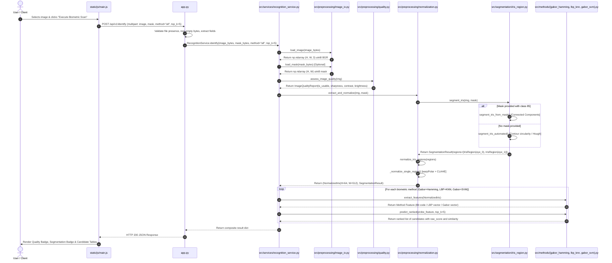

# Detailed Execution Call Graph & Function Workflow

This document traces the exact execution call sequence of the project, detailing:
1. Where input data originates.
2. Which files and functions are consecutively invoked.
3. The exact mathematical and data transformations performed at each step.
4. The exact data structures returned between layers.

---

## Part 1: Online Biometric Identification Workflow (`/api/v1/identify`)

This workflow traces what occurs when an image is submitted for **1:N Identification** via the web UI or REST API.

### High-Level Sequence Diagram



---

### Step-by-Step Function Execution Details

#### 1. Input Acquisition & Request Dispatch
- **File:** `templates/index.html` & [`static/js/main.js`](file:///c:/Users/Piyush/OneDrive/Desktop/iris-recognition-main/iris-recognition-main/static/js/main.js)
  - **Action:** User drags an image into `#imageDropZone` or selects it via `<input type="file" id="imageFileInput">`.
  - **Function:** `scannerForm.addEventListener('submit', async (e) => { ... })`
  - **Operation:**
    1. Reads `selectedImageFile`.
    2. Builds a `FormData` object with keys:
       - `"image"`: raw binary file (`image/jpeg` or `image/png`).
       - `"mask"`: optional binary mask file.
       - `"method"`: `"all"` (or `"gabor_hamming"`, `"lbp_knn"`, `"gabor_svm"`).
       - `"top_k"`: `"5"`.
    3. Dispatches HTTP `POST` to `/api/v1/identify`.

---

#### 2. REST Endpoint Ingestion & Request Validation
- **File:** [`app.py`](file:///c:/Users/Piyush/OneDrive/Desktop/iris-recognition-main/iris-recognition-main/app.py)
  - **Function:** `@app.route("/api/v1/identify", methods=["POST"]) def identify():`
  - **Input:** Flask `request` with `request.files` and `request.form`.
  - **Operations:**
    1. Generates unique UUID4 request ID (`request.request_id = str(uuid.uuid4())`).
    2. Asserts `"image"` is present in `request.files`; returns HTTP 400 JSON error if missing.
    3. Reads binary byte stream: `image_bytes = image_file.read()`.
    4. Validates `len(image_bytes) > 0`; returns HTTP 400 JSON error if empty.
    5. Checks for optional `"mask"` file; reads `mask_bytes` if provided.
    6. Parses `method` (default `"all"`) and `top_k` (default `5`, clamped between 1 and 50).
    7. Calls `recognition_service.identify(...)`.

---

#### 3. Image Decoding & Memory Buffer Ingestion
- **File:** [`src/preprocessing/image_io.py`](file:///c:/Users/Piyush/OneDrive/Desktop/iris-recognition-main/iris-recognition-main/src/preprocessing/image_io.py)
  - **Function:** `load_image(source: Union[bytes, str, Path, np.ndarray], as_gray: bool = False) -> np.ndarray`
  - **Input:** `source = image_bytes`.
  - **Operations:**
    1. Converts byte buffer to uint8 1D array: `np_arr = np.frombuffer(source, np.uint8)`.
    2. Decodes image: `img = cv2.imdecode(np_arr, cv2.IMREAD_COLOR)`.
    3. Checks `img is not None` and `img.size > 0`.
    4. Verifies spatial validity: `img.shape[0] >= 20` and `img.shape[1] >= 20`.
  - **Output:** Decoded BGR image array `img` of shape $(H, W, 3)$ with `dtype=uint8`.

---

#### 4. Biometric Quality Assessment
- **File:** [`src/preprocessing/quality.py`](file:///c:/Users/Piyush/OneDrive/Desktop/iris-recognition-main/iris-recognition-main/src/preprocessing/quality.py)
  - **Function:** `assess_image_quality(img: np.ndarray, min_sharpness=8.0, min_contrast=10.0, ...) -> ImageQualityReport`
  - **Input:** `img` (BGR array).
  - **Operations:**
    1. Converts to grayscale: `gray = cv2.cvtColor(img, cv2.COLOR_BGR2GRAY)`.
    2. Evaluates sharpness via 2D Laplacian variance:
       $$\text{sharpness} = \text{Var}(\nabla^2 I) = \text{cv2.Laplacian}(gray, \text{cv2.CV\_64F}).\text{var}()$$
       *(Flags issue if $< 8.0$)*.
    3. Evaluates contrast via standard deviation: `gray.std()` *(Flags issue if $< 10.0$)*.
    4. Evaluates illumination via mean brightness: `gray.mean()` *(Flags issue if $< 15.0$ or $> 240.0$)*.
    5. Computes dark clipping fraction ($I \le 5$) and highlight clipping fraction ($I \ge 250$).
  - **Output:** `ImageQualityReport(is_usable=True, sharpness=84.3, contrast=46.2, mean_brightness=112.4, issues=[])`.

---

#### 5. Ocular Iris Segmentation
- **File:** [`src/segmentation/iris_region.py`](file:///c:/Users/Piyush/OneDrive/Desktop/iris-recognition-main/iris-recognition-main/src/segmentation/iris_region.py)
  - **Function:** `segment_iris(img: np.ndarray, mask: Optional[np.ndarray] = None) -> SegmentationResult`
  - **Branch A (Mask available with class 85):** `segment_iris_from_mask(img, mask)`
    1. Identifies iris pixels: `iris_bin = (mask == 85).astype(np.uint8)`.
    2. Runs connected component labeling: `cv2.connectedComponentsWithStats(iris_bin)`.
    3. Discards noise components with area $< 80$ pixels.
    4. Sorts valid components left-to-right by X coordinate (`eye_0` = left side of image, `eye_1` = right side of image).
    5. Calls `_extract_crop_patch(img, cx, cy, radius, mask)`:
       - Crops square patch around centroid with side $2 \times 1.35 \times r_{\text{outer}}$.
       - Applies reflection padding (`cv2.BORDER_REPLICATE`) if crops touch image boundaries.
  - **Branch B (Raw unsegmented upload):** `segment_iris_automated(img)`
    1. Checks aspect ratio: if $W/H \ge 1.6$, splits into left and right ocular sub-images.
    2. Calls `_detect_iris_in_subimage()`:
       - Applies Gaussian smoothing (`ksize=(9, 9), sigma=2.0`).
       - Percentile-based dark thresholding ($P_{15}$).
       - Morphological opening (`MORPH_ELLIPSE, 5x5`).
       - Contour circularity scoring $\frac{4\pi \cdot \text{Area}}{\text{Perimeter}^2}$ and Hough circle fallback (`cv2.HoughCircles`).
  - **Output:** `SegmentationResult(success=True, regions=[IrisRegion(eye_idx=0, ...), IrisRegion(eye_idx=1, ...)], method="ground_truth_mask")`.

---

#### 6. Polar Rubber-Sheet Normalization
- **File:** [`src/preprocessing/normalization.py`](file:///c:/Users/Piyush/OneDrive/Desktop/iris-recognition-main/iris-recognition-main/src/preprocessing/normalization.py)
  - **Function:** `normalize_iris_regions(regions: List[IrisRegion], target_height=64, target_width_per_eye=256) -> NormalizedIris`
  - **Operations:**
    1. For each `IrisRegion`, calls `_normalize_single_region()`:
       - Warps square patch into polar coordinates:
         `cv2.warpPolar(gray, (256, 64), (cx, cy), max_r, cv2.WARP_POLAR_LINEAR)`
         *(Produces rectangular strip of height 64 and width 256)*.
       - Applies CLAHE contrast enhancement:
         `cv2.createCLAHE(clipLimit=2.5, tileGridSize=(8, 8)).apply(polar_img)`.
       - Warps mask patch with `cv2.INTER_NEAREST` to produce occlusion mask $(64 \times 256)$.
    2. Horizontally concatenates both eyes:
       $$\text{Image: } [64 \times 256] \,\|\, [64 \times 256] \longrightarrow [\mathbf{64 \times 512}]$$
       $$\text{Mask: } [64 \times 256] \,\|\, [64 \times 256] \longrightarrow [\mathbf{64 \times 512}]$$
  - **Output:** `NormalizedIris(normalized_image, normalized_mask, eye_count=2)`.

---

#### 7. Biometric Feature Extraction & Candidate Matching

The normalized strip is passed to each of the three biometric methods:

##### Execution 7.1: Gabor + Hamming Distance
- **File:** [`src/methods/gabor_hamming.py`](file:///c:/Users/Piyush/OneDrive/Desktop/iris-recognition-main/iris-recognition-main/src/methods/gabor_hamming.py)
  - **Function A:** `extract_features(normalized: NormalizedIris) -> GaborIrisCodeTemplate`
    - Standardizes image to zero-mean and unit variance.
    - Convolves with 8 complex Gabor wavelets (4 orientations $\theta \in \{0, \frac{\pi}{4}, \frac{\pi}{2}, \frac{3\pi}{4}\}$, 2 wavelengths $\lambda \in \{6, 12\}$).
    - Downsamples filter responses to an $8 \times 32$ spatial grid.
    - Quantizes sign into real and imaginary bits: $(\text{mean} \ge 0 \to 1)$.
    - Produces a **1,024-bit binary code** stored as uint8 array $(128 \times 32)$ and matching binary mask $(128 \times 32)$.
  - **Function B:** `predict_ranked(probe_feature, top_k=5) -> List[Dict]`
    - Compares probe against each enrolled subject in `self.gallery`:
      - Calls `compute_pairwise_score(probe, enrolled)`:
        - Evaluates cyclic horizontal rolls $s_1 \in [-2, 2]$ for left eye columns ($0..15$) and $s_2 \in [-2, 2]$ for right eye columns ($16..31$).
        - Computes masked Hamming distance: $\text{HD} = \frac{\sum ((C_A \oplus C_B) \land M_A \land M_B)}{\sum (M_A \land M_B)}$.
        - Takes the minimum distance across all 25 shift combinations.
    - Sorts subjects ascending by Hamming distance (lower is better).
    - Maps `normalized_similarity = max(0.0, 1.0 - (raw_score / 0.5))`.
    - Evaluates `is_match = raw_score <= self.validation_threshold`.

##### Execution 7.2: LBP + K-Nearest Neighbors
- **File:** [`src/methods/lbp_knn.py`](file:///c:/Users/Piyush/OneDrive/Desktop/iris-recognition-main/iris-recognition-main/src/methods/lbp_knn.py)
  - **Function A:** `extract_features(normalized: NormalizedIris) -> np.ndarray`
    - Evaluates 8-neighbor circular LBP vectorially using 8 directional NumPy slice shifts.
    - Partitions the $64 \times 512$ LBP map into a $4 \times 16$ spatial grid (64 blocks).
    - In each block, computes a 32-bin normalized histogram.
    - Concatenates histograms into a **2,048-dimensional vector** and applies global $L_2$ unit normalization.
  - **Function B:** `predict_ranked(probe_feature, top_k=5) -> List[Dict]`
    - Evaluates Euclidean distance to all enrolled gallery vectors: $d = \| V_{\text{probe}} - V_{\text{gallery}} \|_2$.
    - Finds the minimum distance per enrolled subject.
    - Sorts subjects ascending by distance (lower is better).
    - Maps `normalized_similarity = 1.0 / (1.0 + raw_score)`.
    - Evaluates `is_match = raw_score <= self.validation_threshold`.

##### Execution 7.3: Gabor Features + Linear SVM
- **File:** [`src/methods/gabor_svm.py`](file:///c:/Users/Piyush/OneDrive/Desktop/iris-recognition-main/iris-recognition-main/src/methods/gabor_svm.py)
  - **Function A:** `extract_features(normalized: NormalizedIris) -> np.ndarray`
    - Convolves normalized strip with 8 Gabor filters and computes magnitude envelopes: $E_k = \sqrt{F_{\text{real}}^2 + F_{\text{imag}}^2}$.
    - Partitions each magnitude map into 16 blocks ($2 \times 8$).
    - In each block, calculates mean energy ($\mu$) and standard deviation ($\sigma$).
    - Concatenates statistics into a **256-dimensional dense vector** ($8 \times 16 \times 2$) and normalizes by norm.
  - **Function B:** `predict_ranked(probe_feature, top_k=5) -> List[Dict]`
    - Standardizes probe vector via `self.scaler.transform(...)`.
    - Computes signed margin scores via `self.svm_model.decision_function(...)`.
    - Sorts subjects descending by decision score (higher is better).
    - Maps `normalized_similarity = 1.0 / (1.0 + np.exp(-clip(score, -10, 10)))`.
    - Evaluates `is_match = raw_score >= self.validation_threshold`.

---

#### 8. Response Packaging & UI Rendering
- **File:** [`app.py`](file:///c:/Users/Piyush/OneDrive/Desktop/iris-recognition-main/iris-recognition-main/app.py) & [`static/js/main.js`](file:///c:/Users/Piyush/OneDrive/Desktop/iris-recognition-main/iris-recognition-main/static/js/main.js)
  - `app.py` serializes results into JSON:
    ```json
    {
      "request_id": "c1f7b884-...",
      "status": "success",
      "quality": { "is_usable": true, "sharpness": 84.32, "contrast": 46.21, ... },
      "segmentation": { "success": true, "method": "ground_truth_mask", "detected_eyes_count": 2 },
      "enrolled_gallery_size": 25,
      "results": {
        "gabor_hamming": {
          "score_type": "masked_hamming_distance",
          "higher_is_better": false,
          "predicted_subject": "C101",
          "top_candidates": [
            { "rank": 1, "subject_id": "C101", "raw_score": 0.2061, "normalized_similarity": 0.7939, "is_match": true },
            { "rank": 2, "subject_id": "C107", "raw_score": 0.2375, "normalized_similarity": 0.7625, "is_match": true }
          ]
        },
        "lbp_knn": { ... },
        "gabor_svm": { ... }
      }
    }
    ```
  - `main.js` receives the response:
    - Calls `displayResults(data, isVerify=false)`.
    - Updates `#valQualityText` and `#valSegText`.
    - Renders three side-by-side comparison tables showing Candidate Rank, Subject ID, Raw Score (annotated with direction), and animated similarity progress bars.

---

## Part 2: 1:1 Verification Workflow (`/api/v1/verify`)

When the user selects **1:1 Verification** in the UI or calls `POST /api/v1/verify`:

1. **Client Submission:** Form data includes `image`, `method` (`gabor_hamming`), and target `claimed_subject_id` (e.g. `C101`).
2. **API Endpoint:** [`app.py`](file:///c:/Users/Piyush/OneDrive/Desktop/iris-recognition-main/iris-recognition-main/app.py) -> `verify()`:
   - Validates `claimed_subject_id` is non-empty.
   - Calls `recognition_service.verify(image_bytes, claimed_subject_id, mask_bytes, method_name)`.
3. **Execution in `RecognitionService`:**
   - Decodes image via `load_image()`.
   - Runs `assess_image_quality()` and `extract_and_normalize()`.
   - Extracts feature using selected method: `probe_feat = m.extract_features(norm)`.
   - Evaluates ranked match against all enrolled subjects: `m.predict_ranked(probe_feat, top_k=N)`.
   - Locates `claimed_cand = next(c for c in ranked if c['subject_id'] == claimed_subject_id)`.
   - Compares candidate raw score against the validation-derived operating threshold:
     - For distance methods (Hamming, KNN): `is_match = raw_score <= validation_threshold`.
     - For SVM: `is_match = raw_score >= validation_threshold`.
4. **Result Card Rendering (`main.js`):**
   - Displays prominent decision banner:
     - **MATCH (Green `✅`):** `IDENTITY VERIFIED (MATCH)`
     - **NO MATCH (Red `❌`):** `VERIFICATION FAILED (NO MATCH)`
   - Displays side-by-side metrics: Claimed Subject, Raw Score, Operating Threshold, and Normalized Similarity.
   - Clarifies score direction: e.g. *"Lower distance is better. Match requires distance $\le 0.2503$"*.

---

## Part 3: Offline System Startup & Gallery Enrollment Workflow

When `python app.py` is launched, the server pre-warms the biometric gallery:

```
[app.py (__main__)]
      |
      v
[recognition_service.initialize_and_enroll(enrollment_size=3, max_subjects=25)]
      |
      +---> 1. [inventory.run_inventory(sample_decode_limit=50)]
      |        Scans c:\Users\Piyush\OneDrive\Desktop\ubipr2\both_eyes
      |        Inventories 5,509 images & masks, verifies 261 subjects.
      |
      +---> 2. [create_leakage_safe_split(enrollment_size=3, val_samples=2, max_subjects=25)]
      |        Partitions each subject's samples into Session 1 enrollment (3 imgs),
      |        Session 1 validation (2 imgs), and Session 2 test probes (remaining).
      |
      +---> 3. For each method (gabor_hamming, lbp_knn, gabor_svm):
      |        - Extracts features for all 3x25 = 75 enrollment images.
      |        - Calls method.fit(features, labels) to register gallery templates / train SVM.
      |        - Loads calibrated validation threshold (e.g. Hamming=0.2503, KNN=0.3152, SVM=0.9704)
      |          directly from outputs/results/evaluation_summary.json.
      |
      v
[app.run(host="127.0.0.1", port=5000)]
      Ready for real-time inference in under 10 seconds.
```

---

## Part 4: Offline Leakage-Safe Benchmark Evaluation Workflow (`scripts/run_evaluation.py`)

When running `python scripts/run_evaluation.py`:

1. **`DatasetInventory.run_inventory()`:** Indexes all subjects across both sessions.
2. **Outer Loop over Enrollment Sizes $E \in \{1, 3, 5, 10\}$:**
   - Calls `create_leakage_safe_split(enrollment_size=E, val_samples=2, session_aware=True)`.
   - For each method (`gabor_hamming`, `lbp_knn`, `gabor_svm`):
     - Calls `run_identification_evaluation(method, split)`:
       - Measures feature extraction latency per sample.
       - Fits gallery models on enrollment partition ($E \times 25$ samples).
       - Evaluates all disjoint probe test samples ($12 \times 25 = 300$ probes).
       - Computes Rank-1 and Rank-5 accuracies.
3. **1:1 Verification Evaluation:**
   - Calls `run_verification_evaluation(method, split)`:
     - Generates validation genuine and impostor pairs.
     - Sweeps threshold across 200 points to locate Equal Error Rate (EER) threshold.
     - Freezes validation threshold $\tau^*$.
     - Evaluates FAR and FRR on disjoint test pairs using frozen threshold $\tau^*$.
4. **Export Artifacts:**
   - Writes `outputs/results/evaluation_summary.json` and `.csv`.
   - Generates and saves publication charts via `plot_and_save_charts()`:
     - `outputs/figures/identification_accuracy.png`
     - `outputs/figures/verification_roc.png`
     - `outputs/figures/latency_comparison.png`
   - Writes comprehensive report to `reports/evaluation_report.md`.
